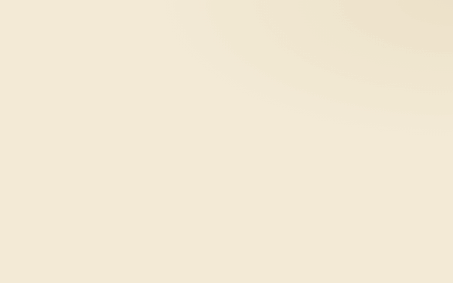

# ReVibe — Landing de lista de espera

Landing de pre-lanzamiento de **ReVibe**, el marketplace para vender y comprar ropa de segunda mano en México. Esta página captura registros (nombre + correo) para la lista de espera antes de que salga la app.

> **Tu clóset vale más.**

🔗 **En vivo:** https://revibe.adriangnaj80.workers.dev



---

## Qué es esto

Un solo archivo `index.html` — todo el HTML, CSS y JavaScript va adentro, sin dependencias ni build. Se abre directo en el navegador.

- **Captura de registros:** el formulario manda nombre + correo a un Google Form conectado a una Google Sheet (no hay backend).
- **Identidad de marca ReVibe:** paleta coral / naranja / teal, tipografía Bagel Fat One (embebida en el archivo como fuente base64, así siempre carga), fondo animado y animaciones tipo spring al entrar.
- **Anti-duplicados:** guarda los correos ya registrados en el navegador (`localStorage`) para no mandar el mismo dos veces.
- **Mecánica de referidos** por WhatsApp para subir de lugar en la fila.

## Cómo verla / editarla

1. Descarga o clona el repo:
   ```
   git clone <URL-del-repo>
   ```
   O usa el botón verde **Code → Download ZIP** aquí en GitHub.
2. Abre `index.html` con doble clic (se ve en cualquier navegador) o con tu editor (VS Code recomendado).
3. Edita el texto/estilos directo en `index.html`. Al guardar, refresca el navegador para ver los cambios.

No necesitas instalar nada. No hay `npm install`, no hay servidor.

## Estructura del archivo

Todo está en `index.html`, en este orden:

- `<style>` — variables de marca (colores, fuentes) al inicio dentro de `:root`, luego todos los estilos.
- El **wordmark** "ReVibe" está armado letra por letra con kerning medido (clases `k-r`, `k-e1`, `k-v`, `k-i`, `k-b`) — respétenlo para que el logo no se deforme.
- El **formulario** y su `<script>` de envío están más abajo. Ojo con las constantes `FORM_ENDPOINT`, `F_EMAIL`, `F_NOMBRE`, `F_REF`: apuntan al Google Form real de ReVibe. **No las cambien** salvo que sepan lo que hacen.
- Fondo animado (`.bg` / `.blob`) y los scripts de parallax y scroll-reveal al final.

## Reglas para no romper la marca

- No quitar la tipografía Bagel Fat One del wordmark — es parte de la identidad.
- Mantener la paleta coral/naranja/teal. Nada de morados o azules random.
- Poco texto. La idea es que con pocas palabras se entienda qué es ReVibe.
- Si tienen duda de un color o espaciado, revisen las variables en `:root` antes de inventar valores nuevos.

## Publicar cambios

La página está hospedada en Cloudflare Workers. Los cambios que hagan aquí **no** se publican solos — hay que subir el `index.html` actualizado a Cloudflare. Coordínense con Adrián para el deploy.
